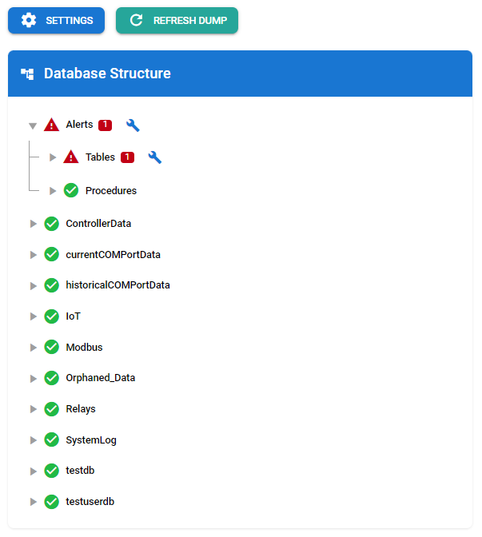

# MySQLSyncr

Warning: Please be careful when using this tool. It is still in development and may not be fully stable. Test on a development database before using on production.

MySQLSyncr is a command-line tool for managing and comparing MySQL database structures with JSON dumps. It allows users to dump the database structure, compare it with existing JSON files, and update the database based on those JSON definitions.

## Table of Contents

- [Features](#features)
- [Installation](#installation)
  - [Global Installation](#global-installation)
  - [Local Installation](#local-installation)
- [Usage](#usage)
  - [Commands](#commands)
  - [Configuration Options](#configuration-options)
- [Using MySQLSyncr as a Module](#using-mysqlsyncr-as-a-module)
- [Contributing](#contributing)
- [License](#license)

## Features

- **Dump**: Export the database structure to JSON files.
- **Compare**: Compare the current database structure with JSON dumps to identify differences.
- **Update**: Update the database structure based on the provided JSON definitions.
- **UI**: Open a web-based database browser interface.
- **Verbose Logging**: Enable detailed logging for debugging purposes.



## Installation

### Global Installation

To install MySQLSync globally, allowing you to use it from the command line, run the following command:

```bash
npm install -g mysqlsyncr
```

This will allow you to run the command as `mysqlsyncr` from anywhere in your terminal.

### Local Installation

If you prefer to use MySQLSyncr locally within a project, you can install it as a dependency:

```bash
npm install mysqlsyncr
```

This will add MySQLSyncr to your project's `node_modules` and allow you to use it within your project.

## Usage

You can run MySQLSync commands using the following syntax:

```bash
mysqlsyncr <command> [options]
```

### Commands

- `dump`: Dumps the database structure to files.
- `compare`: Compares the database structure with JSON dumps (dry run).
- `update`: Updates the database structure based on JSON dumps.
- `ui`: Opens a web-based database browser in your default system browser.
- `rebuild`: Rebuilds each table's columns and indexes in the dump's JSON from its `CREATE TABLE` statement, and lists what changes. Dry run unless `--write` is given. Needs no database connection.

Run `mysqlsyncr` with no command in a terminal and it asks for the command and its options (host, port, user, password, database and folder) instead. The password isn't shown as you type, and `update` asks for confirmation before changing anything.

### Configuration Options

You can configure the following options when running the commands:

| Option      | Alias | Description                                                                 | Default Value                  |
|-------------|-------|-----------------------------------------------------------------------------|--------------------------------|
| `uiPort`    | `-U`  | UI port                                                                     | `3600`                         |
| `openUI`    | `-O`  | Open UI in default browser (boolean)                                      | `true`                         |
| `host`      | `-h`  | Database host                                                              | `localhost`                   |
| `port`      | `-P`  | Database port                                                              | `3306`                         |
| `user`      | `-u`  | Database user                                                              | `root`                         |
| `password`  | `-p`  | Database password (required)                                              |                                |
| `database`  | `-d`  | Target database                                                            | `null`                        |
| `output`    | `-o`  | Output directory for dumping. Default is one level up from the current directory in a new folder called `db-dump` | `../db-dump`                  |
| `verbose`   | `-v`  | Enable verbose logging (boolean)                                          | `false`                       |
| `write`     |       | With `rebuild`, write the rebuilt files (boolean)                         | `false`                       |

### Sync Options File

Put a `syncOptions.json` file in the dump directory (next to the database folders) to control table creation and seed rows. It's optional; without it everything behaves as before.

```json
{
  "definer": "root@%",
  "autoIncrement": false,
  "databases": {
    "Alerts": {
      "AlarmRules": {
        "autoIncrement": 1000,
        "rows": [
          { "idAlarmRule": 1, "name": "Default rule" }
        ]
      },
      "Settings": {
        "rowKey": ["settingName"],
        "rows": [
          { "settingName": "emailEnabled", "value": "1" }
        ]
      }
    }
  }
}
```

**`autoIncrement`** sets the table's `AUTO_INCREMENT=N` counter in `CREATE TABLE`. The `AUTO_INCREMENT` attribute on the id column is never changed. Set it at the top level as the default for every table, and per table to override it.

| Value | Effect |
|-------|--------|
| `true` | Keep the counter as dumped (default) |
| `false` | Remove the counter, so new tables start at 1 |
| A number | Start new tables at that number |

It applies when `dump` saves a table, when `update` creates a missing table, and when `rebuild` rewrites a template. The counter is always ignored when comparing tables.

**`rows`** are seed rows. `compare` reports each row that isn't in the table as `missing_row`, and `update` inserts it after any table and column changes. A row counts as present when a row with the same `rowKey` values exists, so existing rows are never changed. `rowKey` defaults to the table's primary key; every row must include the key columns.

**`definer`** sets the `DEFINER` of every stored procedure, view and trigger, written as `root@%` or `` `root`@`%` ``. The template's definers are replaced with it before comparing, so an object in the database with a different definer is reported and `update` recreates it with this one. `dump` and Keep Current in the UI also save it. The MySQL user running the sync needs the `SET_USER_ID` (or `SUPER`) privilege to create objects for another definer, and the definer user should exist.

### MySQL Versions

MySQL 5.7 and 8.0 print some definitions differently. These are formatting, not structure, so they're ignored when comparing tables, procedures, triggers and views:

- Integer display widths: 5.7 prints `int(11)`, 8.0.19 and later print `int`. `tinyint(1)` and `ZEROFILL` types keep their width on both.
- `YEAR(4)` is printed as `year` from 8.0.19.
- `utf8` is printed as `utf8mb3` from 8.0.24 (fully from 8.0.30).

`dump` records the server's version in `dumpInfo.json`. For templates dumped before that, the version is inferred from the SQL. `compare`, `update` and the UI show the template's and the server's versions and note what differs between them.

When applying a template from 8.0 to a 5.7 server, the `utf8mb4_0900_*` collations 5.7 doesn't have are replaced with `utf8mb4_unicode_ci` (`utf8mb4_bin` for accent- or case-sensitive ones), and each substitution is reported as a warning. Applying also sets `explicit_defaults_for_timestamp` for the session, as 8.0 does by default. Expression defaults such as `DEFAULT (...)` need 8.0.13 or later and fail on 5.7.

### Example Usage

1. **Dump the database structure**:
   ```bash
   mysqlsyncr dump --host localhost --user root --password yourpassword
   ```

2. **Compare the database structure with JSON dumps**:
   ```bash
   mysqlsyncr compare --host localhost --user root --password yourpassword
   ```

3. **Update the database structure based on JSON dumps**:
   ```bash
   mysqlsyncr update --host localhost --user root --password yourpassword
   ```

4. **Open the database browser interface**:
   *Note: This does not work with PowerShell. Must use Command Prompt in windows*
   ```bash
   mysqlsyncr ui --host localhost --user root --password yourpassword
   ```

## Using MySQLSync as a Module

If you want to use MySQLSync as a module in your own Node.js application, you can require it in your code:

```javascript
import mysqlsyncr from 'mysqlsyncr';

// Example usage
const config = {
    host: 'localhost',
    user: 'root',
    password: 'yourpassword',
    database: 'yourdatabase'
};
```

```javascript
// app.js
import mysqlsyncr from 'mysqlsyncr';
import fs from 'fs';
import path from 'path';

// Database configuration
const config = {
    host: 'localhost',
    user: 'root',
    password: 'yourpassword',
    database: 'yourdatabase'
};

// Function to dump the database structure
async function dumpDatabase() {
    try {
        console.log('Dumping the database structure...');
        await mysqlsyncr.dump(config);
        console.log('Database structure dumped successfully.');
    } catch (error) {
        console.error('Error dumping database:', error.message);
    }
}

// Function to compare the database structure with JSON dumps
async function compareDatabase() {
    try {
        const inputDir = path.join(__dirname, 'db-dump'); // Directory where JSON dumps are stored
        console.log('Comparing the database structure with JSON dumps...');
        const differences = await mysqlsyncr.compare(config, inputDir);
        
        if (differences.length > 0) {
            console.log('Differences found:');
            console.log(differences);
        } else {
            console.log('No differences found. The database structure matches the JSON dumps.');
        }
    } catch (error) {
        console.error('Error comparing database:', error.message);
    }
}

// Main function to execute dump and compare
(async () => {
    await dumpDatabase();
    await compareDatabase();
})();
```

Make sure to check the source code for available functions and their usage.

## Contributing

Contributions are welcome! If you would like to contribute to MySQLSyncr, please follow these steps:

1. Fork the repository.
2. Create a new branch for your feature or bug fix.
3. Make your changes and commit them with clear messages.
4. Push your changes to your forked repository.
5. Open a pull request to the main repository.

Before committing, run `npm test` and `npm run build`, which rebuilds `dist/` from `src/`. If you changed the UI (`ui/src`), also rebuild `ui/dist` with `npm run build` in `ui/`. That needs Node.js 22.22.0 or later; see [ui/README.md](ui/README.md). Running or installing mysqlsyncr has no such requirement.


## License

This project is licensed under the ISC License. See the [LICENSE](LICENSE) file for more details.
