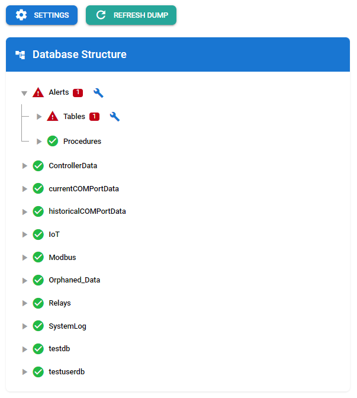

# MySQLSyncr

Warning: Please be careful when using this tool. It is still in development and may not be fully stable. Test on a development database before using on production.

MySQLSyncr is a command-line tool for managing and comparing MySQL database structures with JSON dumps. It allows users to dump the database structure, compare it with existing JSON files, and update the database based on those JSON definitions.

## Table of Contents

- [Features](#features)
- [Installation](#installation)
  - [Global Installation](#global-installation)
  - [Local Installation](#local-installation)
- [Usage](#usage)
  - [Commands](#commands)
  - [Configuration Options](#configuration-options)
- [Using MySQLSyncr as a Module](#using-mysqlsyncr-as-a-module)
- [Contributing](#contributing)
- [License](#license)

## Features

- **Dump**: Export the database structure to JSON files.
- **Compare**: Compare the current database structure with JSON dumps to identify differences.
- **Update**: Update the database structure based on the provided JSON definitions.
- **UI**: Open a web-based database browser interface.
- **Performance**: Find slow application queries and assess execution plans against existing indexes through the UI, CLI, or module API.
- **Verbose Logging**: Enable detailed logging for debugging purposes.



## Installation

### Global Installation

To install MySQLSync globally, allowing you to use it from the command line, run the following command:

```bash
npm install -g mysqlsyncr
```

This will allow you to run the command as `mysqlsyncr` from anywhere in your terminal.

### Local Installation

If you prefer to use MySQLSyncr locally within a project, you can install it as a dependency:

```bash
npm install mysqlsyncr
```

This will add MySQLSyncr to your project's `node_modules` and allow you to use it within your project.

## Usage

You can run MySQLSync commands using the following syntax:

```bash
mysqlsyncr <command> [options]
```

### Commands

- `dump`: Dumps the database structure to files.
- `compare`: Compares the database structure with JSON dumps (dry run).
- `update`: Updates the database structure based on JSON dumps.
- `ui`: Opens a web-based database browser in your default system browser.
- `performance`: Reports slow query patterns and potential index issues without changing data or creating indexes.
- `rebuild`: Rebuilds each table's columns and indexes in the dump's JSON from its `CREATE TABLE` statement, and lists what changes. Dry run unless `--write` is given. Needs no database connection.

Run `mysqlsyncr` with no command in a terminal and it asks for the command and its options (host, port, user, password, database and folder) instead. The password isn't shown as you type, and `update` asks for confirmation before changing anything.

### Configuration Options

You can configure the following options when running the commands:

| Option      | Alias | Description                                                                 | Default Value                  |
|-------------|-------|-----------------------------------------------------------------------------|--------------------------------|
| `uiPort`    | `-U`  | UI port                                                                     | `3600`                         |
| `uiHost`    |       | UI listen address; remote access requires an explicit bind address | `127.0.0.1` |
| `openUI`    | `-O`  | Open UI in default browser (boolean)                                      | `true`                         |
| `host`      | `-h`  | Database host                                                              | `localhost`                   |
| `port`      | `-P`  | Database port                                                              | `3306`                         |
| `user`      | `-u`  | Database user                                                              | `root`                         |
| `password`  | `-p`  | Database password (required)                                              |                                |
| `database`  | `-d`  | Target database                                                            | `null`                        |
| `output`    | `-o`  | Output directory for dumping. Default is one level up from the current directory in a new folder called `db-dump` | `../db-dump`                  |
| `verbose`   | `-v`  | Enable verbose logging (boolean)                                          | `false`                       |
| `write`     |       | With `rebuild`, write the rebuilt files (boolean)                         | `false`                       |

### Sync Options File

Put a `syncOptions.json` file in the dump directory (next to the database folders) to control table creation and seed rows. It's optional; without it everything behaves as before.

```json
{
  "definer": "root@%",
  "autoIncrement": false,
  "databases": {
    "Alerts": {
      "AlarmRules": {
        "autoIncrement": 1000,
        "rows": [
          { "idAlarmRule": 1, "name": "Default rule" }
        ]
      },
      "Settings": {
        "rowKey": ["settingName"],
        "rows": [
          { "settingName": "emailEnabled", "value": "1" }
        ]
      }
    }
  }
}
```

**`autoIncrement`** sets the table's `AUTO_INCREMENT=N` counter in `CREATE TABLE`. The `AUTO_INCREMENT` attribute on the id column is never changed. Set it at the top level as the default for every table, and per table to override it.

| Value | Effect |
|-------|--------|
| `true` | Keep the counter as dumped (default) |
| `false` | Remove the counter, so new tables start at 1 |
| A number | Start new tables at that number |

It applies when `dump` saves a table, when `update` creates a missing table, and when `rebuild` rewrites a template. The counter is always ignored when comparing tables.

**`rows`** are seed rows. `compare` reports each row that isn't in the table as `missing_row`, and `update` inserts it after any table and column changes. A row counts as present when a row with the same `rowKey` values exists, so existing rows are never changed. `rowKey` defaults to the table's primary key; every row must include the key columns.

**`definer`** sets the `DEFINER` of every stored procedure, view and trigger, written as `root@%` or `` `root`@`%` ``. The template's definers are replaced with it before comparing, so an object in the database with a different definer is reported and `update` recreates it with this one. `dump` and Keep Current in the UI also save it. The MySQL user running the sync needs the `SET_USER_ID` (or `SUPER`) privilege to create objects for another definer, and the definer user should exist.

### MySQL Versions

MySQL 5.7 and 8.0 print some definitions differently. These are formatting, not structure, so they're ignored when comparing tables, procedures, triggers and views:

- Integer display widths: 5.7 prints `int(11)`, 8.0.19 and later print `int`. `tinyint(1)` and `ZEROFILL` types keep their width on both.
- `YEAR(4)` is printed as `year` from 8.0.19.
- `utf8` is printed as `utf8mb3` from 8.0.24 (fully from 8.0.30).

`dump` records the server's version in `dumpInfo.json`. For templates dumped before that, the version is inferred from the SQL. `compare`, `update` and the UI show the template's and the server's versions and note what differs between them.

When applying a template from 8.0 to a 5.7 server, the `utf8mb4_0900_*` collations 5.7 doesn't have are replaced with `utf8mb4_unicode_ci` (`utf8mb4_bin` for accent- or case-sensitive ones), and each substitution is reported as a warning. Applying also sets `explicit_defaults_for_timestamp` for the session, as 8.0 does by default. Expression defaults such as `DEFAULT (...)` need 8.0.13 or later and fail on 5.7.

### Example Usage

1. **Dump the database structure**:
   ```bash
   mysqlsyncr dump --host localhost --user root --password yourpassword
   ```

2. **Compare the database structure with JSON dumps**:
   ```bash
   mysqlsyncr compare --host localhost --user root --password yourpassword
   ```

3. **Update the database structure based on JSON dumps**:
   ```bash
   mysqlsyncr update --host localhost --user root --password yourpassword
   ```

4. **Open the database browser interface**:
   ```bash
   mysqlsyncr ui --host localhost --user root --password yourpassword
   ```

The UI listens on loopback by default. To use it from another computer, explicitly
set `--uiHost` to the intended interface (for example `--uiHost 0.0.0.0` on a
trusted network). The UI has database repair privileges and no user login; do not
expose it publicly. Browser API requests must come from the UI's own origin.
Connection passwords stay in memory for the current page session and are no
longer stored in the browser's local storage.

`update` creates databases and tables before adding foreign keys across schemas,
then restores procedures, views, triggers and configured seed rows. It checks the
result again and exits nonzero on a failed or incomplete update. Comparison and
dump errors are reported instead of being treated as an empty, synchronized
database. Extra objects can still be removed when applying differences, as in
previous versions; review the differences first.

Database dumps contain schema definitions and optional configured seed rows.
They are not backups of all deployed row data.

### Repeatable validation

```sh
npm ci
npm ci --prefix ui
npm test -- --runInBand
npm run test:ui
npm run build
npm run build --prefix ui
npm run test:browser
npm run test:integration -- --template /absolute/path/to/CAM/sql/DBTemplate
```

The integration command creates labeled, disposable MySQL 5.7 and 8.0 Docker
containers on dynamically allocated loopback ports. It refuses unowned containers,
copies the template, restores all schemas, deliberately changes test schemas,
checks repairs and data preservation, tests performance/CLI/API behavior, and
restores dumps across versions. It never reads `.env` or application credentials.
Docker and permission to create and mutate disposable test databases are required.
Use `--artifacts /path/outside/mysqlsyncr` to retain the JSON report and dumps.
The original template's hash is checked for changes at the end. Browser tests use
mocked APIs and installed Chrome; see [UI test instructions](ui/tests/README.md).

### Query performance and index assessment

Configure your connection in the UI's Settings, then use **Query Performance → Check performance**. No database dump or slow-query log is required. Leave the schema field blank to inspect all application schemas. Schema-inspection statements and queries referencing system schemas are excluded before limiting results.

The UI displays average, maximum, and total execution times in seconds, with units beside the values. All result categories respect the configured duration threshold (default `2` seconds, minimum `1`). Cumulative query lists require a recorded maximum execution time strictly greater than the threshold, including highest-total-time and temporary-table/sort categories. Interval results require their interval average above the threshold; live queries use elapsed time, and blocking transactions use wait age. Exactly the threshold does not qualify. The CLI/API retain milliseconds for `slowMs` (default `2000`, minimum `1000`) and the `avg_ms`, `max_ms`, and `total_ms` report fields.

```bash
mysqlsyncr performance --host localhost --user monitor --password yourpassword --database myapp
mysqlsyncr performance --database myapp --slowMs 1000 --minExecutions 1 --minRowsExamined 1000 --scanRatio 1000 --limit 10 --json
```

| Option | Default | Meaning |
| --- | --- | --- |
| `--slowMs` | 2000 | Duration threshold across all categories in milliseconds; minimum 1000 |
| `--minExecutions` | 6 | Minimum execution count for either category |
| `--minRowsExamined` | 1000 | Minimum cumulative rows examined for index review |
| `--scanRatio` | 1000 | Examined/sent row ratio threshold; use 1 as denominator when no rows were sent |
| `--limit` | 10 | Maximum results per category, from 1 to 100 |
| `--database` | All application schemas | Filter by the default schema recorded for each digest |
| `--json` | false | Print a structured report for application monitoring/alerting code |

Every returned slow query and index candidate includes an `indexAssessment`. The checker retrieves a captured sample, reads the referenced base tables' indexes, and runs `EXPLAIN FORMAT=TRADITIONAL`. Expand **Execution plan and existing indexes** to see table names, chosen/possible indexes, estimated rows, access types, and existing index columns in order (including prefix lengths).

| Assessment | Meaning |
| --- | --- |
| Index may help | A sample with column conditions scans at least 1,000 estimated rows without a possible lookup index |
| Review existing indexes | A substantial scan was chosen despite possible indexes; investigate selectivity, statistics, and query shape |
| Index already used | The plan already uses lookup/range index access; slowness alone does not establish a missing index |
| Scan without filtering | No recognized indexable column condition; an index alone may not reduce the work |
| No index issue evident in this plan | No substantial scan was identified in this sample; this does not guarantee optimal indexes |
| Index assessment inconclusive | Samples are missing, SQL is unsupported, a view is involved, or permissions/planning failed |

Requires MySQL Performance Schema, statement instrumentation, and the `statements_digest` consumer, with SELECT permission on the queried statistics tables. Disabled/empty collection produces warnings rather than claiming healthy performance. Disabled Performance Schema returns an unavailable report (CLI exit status 1). Statistics are cumulative since collection began or was reset, not a recent time window. Schema filtering uses the statement's default database rather than every database referenced by cross-schema SQL.

MySQL 8's `QUERY_SAMPLE_TEXT` supplies actual parameter values when available. Older servers fall back to retained matching statements in `events_statements_history_long`, which requires history collection. Missing samples are inconclusive; normalized placeholders are never filled with invented values. Automatic planning supports a conservative subset of SELECTs over base tables, including explicit joins and nested IN/EXISTS SELECT predicates with distinct table aliases. Predicates are attributed within each query block, including qualified correlated references. MySQL plans the entire query together; semijoin base-table accesses are mapped by alias, while generated materialized-subquery lookup keys are explained separately rather than treated as base-table indexes. Leading-wildcard LIKE values receive a diagnostic note without exposing the sample value. Function calls, scalar/derived-table subqueries, CTEs, repeated aliases across blocks, views, writes, comments, multiple statements, and unsupported syntax remain inconclusive. Up to eight SELECT blocks and eight base-table references are supported. It never uses `EXPLAIN ANALYZE`, executes the sample standalone, enables instrumentation, resets counters, or creates indexes. Literal sample text is not returned; inspection errors expose codes rather than messages that could contain sample values.

Assessments use a current estimated sample plan, which can differ from the historical slow execution. They do not prescribe exact index columns or generate DDL. Plan/index inspection requires appropriate table visibility and EXPLAIN privileges. `checkPerformance` creates and closes its own monitoring connection; planning changes that connection's default schema. The CLI runs once and does not schedule checks or send email.

```javascript
import { checkPerformance } from 'mysqlsyncr';
const report = await checkPerformance(config, {
    database: 'myapp', slowMs: 1000, minExecutions: 1, limit: 10,
});
// report.available, report.warnings, report.slowQueries, report.indexCandidates
// Each query has an indexAssessment containing status, summary, and tables.
```

The UI uses `POST /api/performance` with `{ config, options }` and the same report format.

## Using MySQLSync as a Module

If you want to use MySQLSync as a module in your own Node.js application, you can require it in your code:

```javascript
import * as mysqlsyncr from 'mysqlsyncr';

// Example usage
const config = {
    host: 'localhost',
    user: 'root',
    password: 'yourpassword',
    database: 'yourdatabase'
};
```

```javascript
// app.js
import * as mysqlsyncr from 'mysqlsyncr';
import fs from 'fs';
import path from 'path';

// Database configuration
const config = {
    host: 'localhost',
    user: 'root',
    password: 'yourpassword',
    database: 'yourdatabase'
};

// Function to dump the database structure
async function dumpDatabase() {
    const checker = new mysqlsyncr.DBStructureChecker(config);
    try {
        console.log('Dumping the database structure...');
        await checker.ready();
        const output = path.resolve('db-dump');
        fs.mkdirSync(output, { recursive: true });
        await mysqlsyncr.dumpAllDatabases(checker.connection, 'dump', { output, database: config.database });
        console.log('Database structure dumped successfully.');
    } catch (error) {
        console.error('Error dumping database:', error.message);
    } finally {
        await checker.closeConnection();
    }
}

// Function to compare the database structure with JSON dumps
async function compareDatabase() {
    try {
        const inputDir = path.resolve('db-dump');
        console.log('Comparing the database structure with JSON dumps...');
        const { diffs: differences } = await mysqlsyncr.compare(config, inputDir);
        
        if (Object.values(differences).some(items => items.length > 0)) {
            console.log('Differences found:');
            console.log(differences);
        } else {
            console.log('No differences found. The database structure matches the JSON dumps.');
        }
    } catch (error) {
        console.error('Error comparing database:', error.message);
    }
}

// Main function to execute dump and compare
(async () => {
    await dumpDatabase();
    await compareDatabase();
})();
```

Make sure to check the source code for available functions and their usage.

## Additional performance diagnostics

**Query Performance** groups collected statements by database, with categories
for slow queries, index review, highest total query time, temporary tables/sorting,
and activity since the previous check. Query details show temporary-table counts,
disk temporary-table counts, sorted rows, and sort merge passes alongside timings
in seconds. These counters identify work to investigate, not a proven missing
index. Disk temporary-table counts do not capture every TempTable overflow path.

Live queries and blocking InnoDB transactions appear in the same database tree.
These are point-in-time observations filtered by the configured duration threshold. Blocking
entries show waiting/blocking connection IDs, wait seconds, table/index and locked
row counts. Live queries show normalized SQL, connection ID, state and elapsed
seconds when instrumentation provides it. No raw SQL samples, lock values, or
session-kill actions are exposed. An empty snapshot cannot rule out intermittent
blocking. Missing permissions or unsupported diagnostics are shown as unavailable.

Run **Check performance** once to capture a baseline. Run it again after your
workload to see counter differences, interval executions, average and total time
under **Activity since previous check**. The minimum executions setting applies
to interval executions, and the interval average must exceed the configured duration threshold. Interval maximum time cannot be derived and is shown as
unavailable. New, reset, or uncomparable digests are omitted and counted in the
interval notice; they can be compared on subsequent checks. Snapshots are
best-effort, not transactionally atomic, and may omit statements in flight.

Baselines stay in backend memory for 15 minutes, with at most 20 retained and a
5,000-digest scope limit. Restarting mysqlsyncr, changing database/server/account,
MySQL restarts, expired baselines, or exceeding that limit requires a new baseline.
No Performance Schema counters are reset. Narrow the schema for larger workloads.
The CLI `performance` output and `--json` include the additional cumulative and
live diagnostics; interval comparison is available across UI/API requests to the
same running backend using the returned `snapshotId` as `options.baselineId`.

Diagnostics require SELECT access to the relevant Performance Schema tables and
`sys.innodb_lock_waits` plus underlying privileges (including PROCESS where
required). Current statements require enabled instrumentation and the
`events_statements_current` consumer. mysqlsyncr does not change instrumentation,
server settings, indexes or transactions. AI is optional and disabled in the UI
until enabled in Performance Settings.

## Local AI query analysis

The Query Performance panel supports optional, review-only analysis using a local
Ollama model. This works alongside a regular MySQL server; MySQL AI or HeatWave is
not required. Node.js 18 or later is required for this optional feature.

1. Install [Ollama](https://ollama.com/download) on the machine running mysqlsyncr
   and start it (or run `ollama serve`).
2. Run `ollama pull llama3.2:3b`. This is Ollama's model tag for Llama 3.2 3B;
   `llama3.2-3b-instruct-v1` is the MySQL AI/HeatWave identifier.
3. Restart mysqlsyncr after rebuilding the backend and UI. Refresh the browser.
4. Open the gear icon in **Query Performance**, enable **optional AI analysis**,
   then use **Check AI connection** under **Local AI settings**. Run **Check
   performance**, open a query, and select **Analyze with AI**.

The backend sends normalized digest SQL, schema/table/column names and types,
existing indexes, cumulative timings in seconds, and an estimated plan when the
existing conservative planner supports the captured sample. It does not send
connection credentials, literal query samples, column defaults, or table rows.
Nested queries can receive metadata-based advice even when automatic EXPLAIN is
unsupported; the missing plan is explicitly reported. Metadata discovery is
best-effort and may omit implicit joins and complex syntax.

The default endpoint is `http://127.0.0.1:11434`. For a separately hosted Ollama
instance, set `MYSQLSYNCR_OLLAMA_URL` in the **backend's environment**, then restart.
That sends query metadata to the configured host. The browser cannot change the
endpoint. The model field selects an already installed local model; it does not
download models. No additional npm package or API key is needed.

Results are displayed as text with possible bottlenecks, index and query
suggestions, verification steps, and limitations. Suggestions are not executed.
Validate column order, selectivity, existing index overlap, and write/storage
costs before making any schema changes. Requests time out after 120 seconds;
first use may be slower while the model loads. Connection and missing-model
errors are shown in the UI.

## Contributing

Contributions are welcome! If you would like to contribute to MySQLSyncr, please follow these steps:

1. Fork the repository.
2. Create a new branch for your feature or bug fix.
3. Make your changes and commit them with clear messages.
4. Push your changes to your forked repository.
5. Open a pull request to the main repository.

Before committing, run `npm test` and `npm run build`, which rebuilds `dist/` from `src/`. If you changed the UI (`ui/src`), also rebuild `ui/dist` with `npm run build` in `ui/`. That needs Node.js 22.22.0 or later; see [ui/README.md](ui/README.md). Running or installing mysqlsyncr has no such requirement.


## License

This project is licensed under the ISC License. See the [LICENSE](LICENSE) file for more details.
